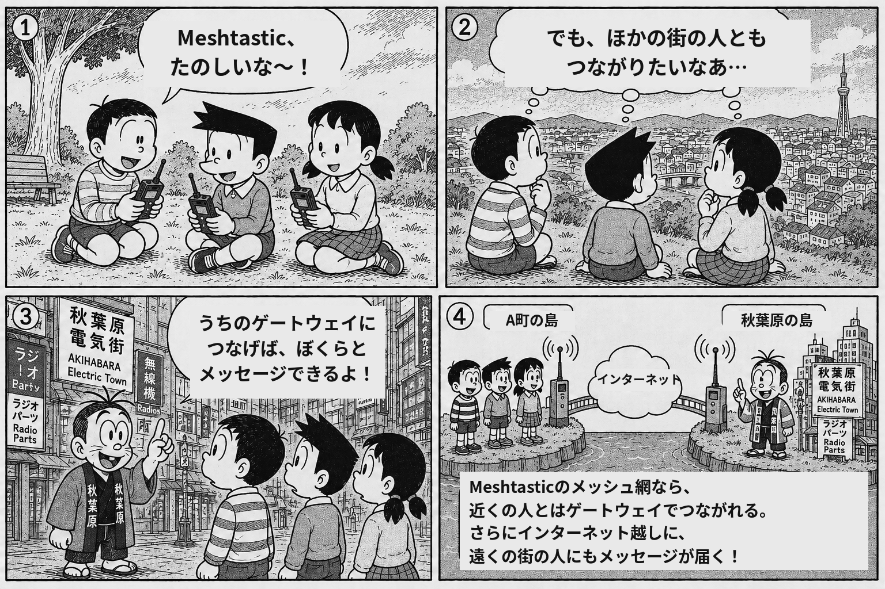
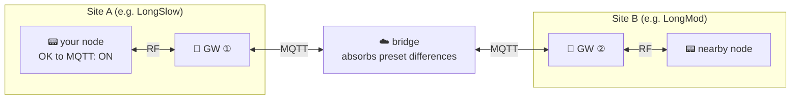

# 🛰️ ptp mesh

Japan has few Meshtastic nodes, so a device you just bought often has nobody to talk to. Your first contact ends up being the second device you bought yourself. Connect to the official MQTT broker and you get zero-hop delivery — an internet messaging terminal, not a mesh.

So we built an experimental Meshtastic MQTT bridge that stitches distant sites together **with hops preserved, even across different modem presets** (LongFast / LongMod / LongSlow …).

Participation is open, the same model as the official public MQTT: connect to the server and you're in.

{ loading=lazy }

[How to join](connect.md){ .md-button .md-button--primary }
[Get on the public map](map.md){ .md-button }

## How it works

Meshtastic nodes acting as gateways (GW) connect to the MQTT server and re-radiate over RF what the other sites picked up. The bridge rewrites the channel hash to match the destination's preset, so **each site keeps its locally optimal preset** and they still decode each other.

As the diagram shows, **your own node does not need MQTT at all** — being within RF range of a gateway is enough (just turn on "OK to MQTT" in LoRa settings; [details](connect.md)).

## "Groups" = root topics (a two-layer model)

The root topic is the **group name** that decides how far a message travels. A gateway is an **entrance** to that group (the RF window), and one group can have many gateways.

- **Delivery = root topic.** Messages reach only people on the same root. `ptp/commons` is the shared public group; `ptp/<any-name>` is an independent group of your own. Start with **`ptp/commons`**.
- **Secrecy = PSK.** commons uses the default PSK (`AQ==`), so it is readable by anyone. To make your own group private, add a **named channel with your own PSK** (separate root + your own PSK = a genuinely private group).

See [Groups and gateways](gateways.md) for what exists today.

## What you can use here

- **[kbot](kbot.md)** — an always-on bot. DM it and it answers with earthquake, weather-warning and typhoon information.
- **[`ptp-bousai`](bousai.md)** — an opt-in channel that broadcasts Japanese disaster information as it arrives.

## Gateways currently running

Permanent gateways run in Tokyo: Hounancho, Sendagaya and Akihabara (one of them goes offline at night). See [Gateways](gateways.md).

!!! warning "This is an experiment"
    A hobbyist-run experimental network. It may stop or change without notice. Feedback welcome.
